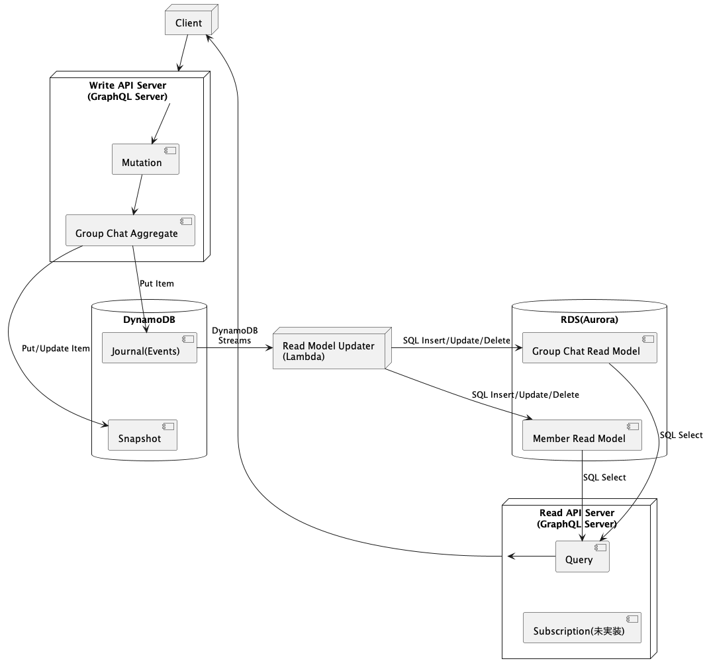

# cqrs-es-example-java

## Overview

Status: In Implementation

This is an example of CQRS/Event Sourcing and GraphQL implemented in Java.

This project uses [j5ik2o/event-store-adapter-java](https://github.com/j5ik2o/event-store-adapter-java) for Event Sourcing.

Please refer to [here](https://github.com/j5ik2o/cqrs-es-example) for implementation examples in other languages.

[日本語](./README.ja.md)

## Feature

- [x] Write API Server(GraphQL)
- [x] Read API Server(GraphQL)
- [x] Read Model Updater on Local
- [x] Docker Compose Support
- [ ] Read Model Updater on AWS Lambda
- [ ] Deployment to AWS

## Overview

### Component Composition

- Write API Server
    - API is implemented by GraphQL (Mutation)
    - Event Sourced Aggregate is implemented by [j5ik2o/event-store-adapter-java](https://github.com/j5ik2o/event-store-adapter-java)
- Read Model Updater
    - headテーブルのDynamoDB Streamsに基づいてリードモデルを構築する
    - ローカルで、Lambdaの動作をエミュレートするコードを実行する(local-rmu)
- Read API Server
    - API is implemented by GraphQL (Query)

ローカルのRead Model UpdaterはheadテーブルのStreamsを購読する。重複した`seq_nr`と古い`seq_nr`は捨て、欠番はジャーナルから補う。処理済みの位置は、リードモデルの更新と同じデータベーストランザクションで`read_model_positions`に記録する。

### System Architecture Diagram

## Development Environment

- [Tool Setup](docs/TOOLS_INSTALLATION.ja.md)
- [Build and Test](docs/BUILD_AND_TEST.ja.md)

### Local Environment

- [Debugging on Local Machine](docs/DEBUG_ON_LOCAL_MACHINE.ja.md)
- [Debugging on Docker Compose](docs/DEBUG_ON_DOCKER_COMPOSE.ja.md)

## Links

- [Common Documents](https://github.com/j5ik2o/cqrs-es-example)
