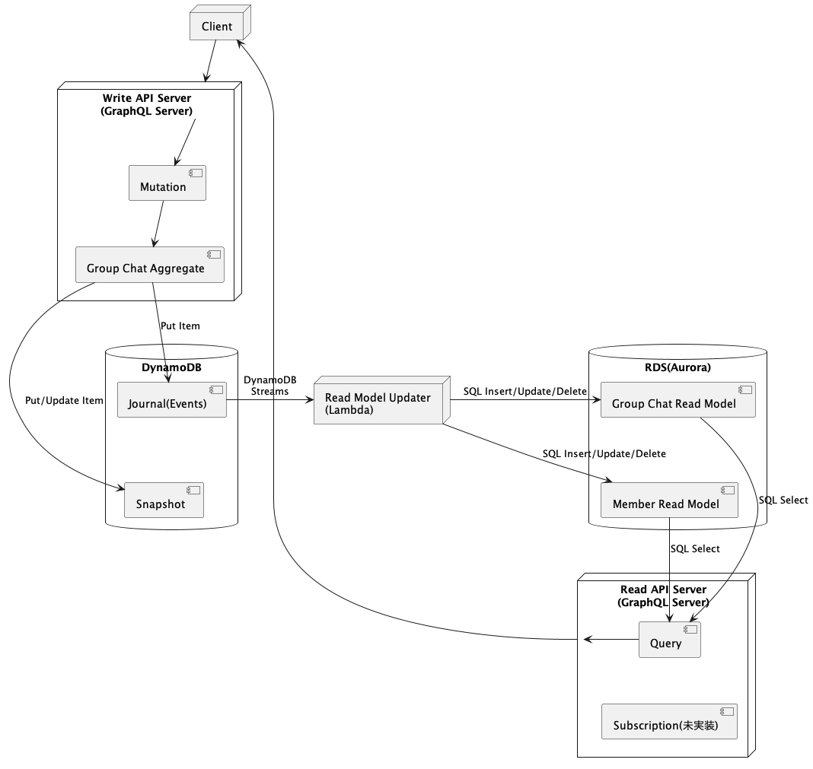

# cqrs-es-example-java

[](https://github.com/j5ik2o/cqrs-es-example-java/actions/workflows/ci.yml)
[](https://renovatebot.com)
[](https://opensource.org/licenses/apache-2-0)
[](https://opensource.org/licenses/MIT)
[](https://github.com/XAMPPRocky/tokei)

## Overview

Status: In Implementation

This is an example of CQRS/Event Sourcing and GraphQL implemented in Java. This example is class-based, not actor-model based.

This project uses [j5ik2o/event-store-adapter-java](https://github.com/j5ik2o/event-store-adapter-java) for Event Sourcing.

Please refer to [here](https://github.com/j5ik2o/cqrs-es-example) for implementation examples in other languages.

[日本語](./README.ja.md)

## Feature

- [x] Write API Server(GraphQL)
- [x] Read API Server(GraphQL)
- [x] Read Model Updater on Local
- [x] Docker Compose Support
- [ ] Read Model Updater on AWS Lambda
- [ ] Deployment to AWS

## Overview

### Component Composition

- Write API Server
  - API is implemented by GraphQL (Mutation)
  - Event Sourced Aggregate is implemented by [j5ik2o/event-store-adapter-java](https://github.com/j5ik2o/event-store-adapter-java)
- Read Model Updater
  - Builds read models from the head table's DynamoDB Streams
  - Locally, run code that emulates Lambda behavior (local-rmu)
- Read API Server
  - API is implemented by GraphQL (Query)

The local Read Model Updater subscribes to the head table's Streams. It drops duplicate and stale
`seq_nr` values, fills a gap from the journal, and records the applied position in
`read_model_positions` in the same database transaction as the read model update.

The AWS deployment asset and its runbook are in [deploy/README.ja.md](deploy/README.ja.md).

### System Architecture Diagram



## Development Environment

- [Tool Setup](docs/TOOLS_INSTALLATION.md)
- [Build and Test](docs/BUILD_AND_TEST.md)

### Local Environment

- [Local application ports and environment variables](docs/LOCAL_CONFIGURATION.md)

- [Debugging on Local Machine](docs/DEBUG_ON_LOCAL_MACHINE.md)
- [Debugging on Docker Compose](docs/DEBUG_ON_DOCKER_COMPOSE.md)

### End-to-End Test

Build the application image and run the compose stack with LocalStack:

```sh
./tools/scripts/docker-build.sh
./tools/scripts/docker-compose-e2e-test.sh
```

The script starts LocalStack, MySQL, the three applications, and the e2e test container. It returns the e2e test's exit code and prints the compose logs when the test fails. It then restarts the read model updater and runs the test again, so a replay of the retained head Streams must not duplicate the read model.

## Links

- [Common Documents](https://github.com/j5ik2o/cqrs-es-example)
